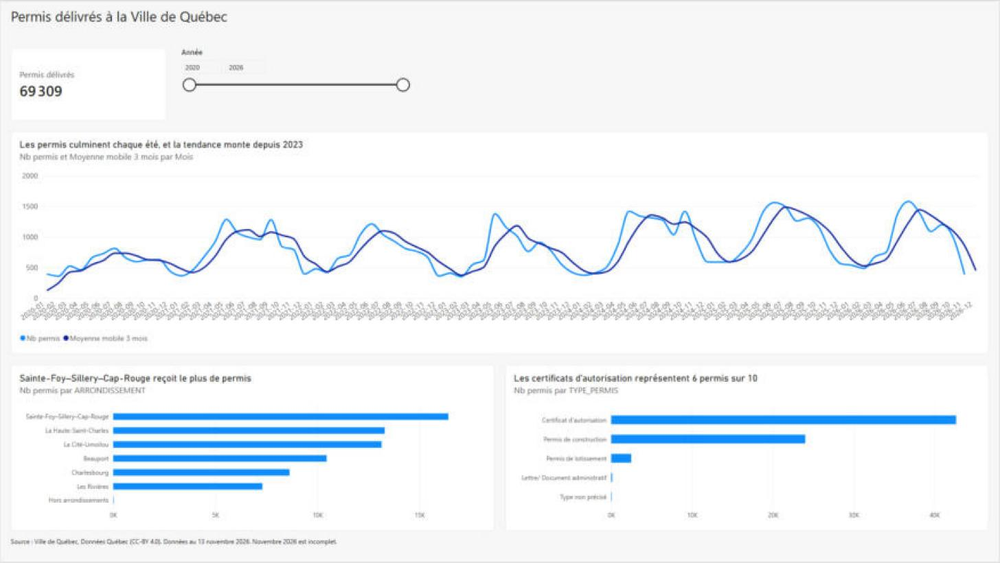
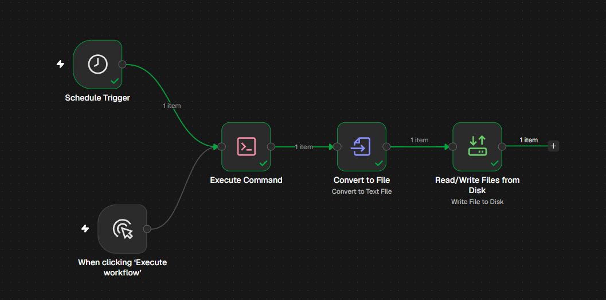

# Permis délivrés à la Ville de Québec (2020–2026)

Ce projet d'analyse de données couvre toute la chaîne, de la donnée ouverte brute jusqu'au rapport hebdomadaire automatisé : SQL, Python, Excel, Power BI, Claude (skill + serveur MCP) et n8n.



## Le problème

La Ville de Québec publie chaque semaine la liste des permis qu'elle délivre. Le fichier brut ne permet pas de suivre l'activité facilement : il contient des doublons et du texte non normalisé, et il ne donne aucun indicateur. Le projet répond à quatre questions :

1. Combien de permis sont délivrés chaque mois, et la tendance monte-t-elle ?
2. Y a-t-il une saisonnalité ?
3. Quels types de permis dominent ?
4. Quels arrondissements sont les plus actifs ?

Le détail des questions se trouve dans [docs/questions_metier.md](docs/questions_metier.md).

## Les résultats principaux

| Indicateur | Valeur |
|---|---|
| Lignes brutes | 71 612 |
| Doublons exacts retirés | 2 303 |
| Permis analysés | **69 309** (du 3 janvier 2020 au 13 novembre 2026) |
| Permis délivrés en 2020 → 2025 | 6 896 → 12 387 (+80 %) |
| Type dominant | Certificat d'autorisation (61,6 %) |
| Arrondissement le plus actif | Sainte-Foy–Sillery–Cap-Rouge (23,7 %) |

- Les délivrances culminent chaque été. La tendance est à la hausse depuis 2023 (8 891 en 2023, 11 520 en 2024, 12 387 en 2025).
- Les totaux sont identiques dans SQL, Python, Excel et Power BI : les écarts du contrôle croisé sont tous de 0.
- Novembre 2026 est incomplet (données jusqu'au 13) : il n'est jamais comparé à un mois complet.

## Architecture

```
Données Québec (CSV, chaque semaine)
        │
        ▼
n8n ── chaque lundi 7 h ──► python/pipeline.py
                              ├─ télécharge le CSV          → data/raw/
                              ├─ charge et nettoie en SQL   → data/clean/permis.db
                              └─ exporte 5 indicateurs CSV  → data/clean/
        │
        ├─► journal d'exécution        → reports/journal_AAAA-MM-JJ.txt
        ├─► Excel (contrôle) et Power BI (tableau de bord)
        └─► Claude : serveur MCP en lecture seule + skill « rapport-permis-hebdo »
                     → rapport hebdomadaire rédigé à partir de la base
```



## Outils et étapes

| Étape | Outil | Fichiers |
|---|---|---|
| Exploration | Python, pandas, JupyterLab | `notebooks/01_exploration.ipynb` |
| Chargement et nettoyage | SQLite, SQL | `sql/01_create_tables.sql`, `sql/02_controles_qualite.sql` |
| Indicateurs | SQL (`GROUP BY`, sous-requêtes, `LAG`) | `sql/03_indicateurs.sql` |
| Analyse et graphiques | pandas, matplotlib | `notebooks/03_nettoyage.ipynb`, `notebooks/04_analyse.ipynb`, `reports/figures/` |
| Contrôle croisé | Excel (tableaux croisés dynamiques) | `excel/controle_permis.xlsx` |
| Tableau de bord | Power BI (DAX : variation mensuelle, moyenne mobile 3 mois) | `powerbi/permis_tableau_de_bord.pbix` |
| Rapport rédigé par l'IA | Claude Skill | `skills/rapport-permis-hebdo/SKILL.md` |
| Accès de l'IA à la base | Serveur MCP Python, lecture seule | `python/serveur_mcp.py` |
| Automatisation | n8n (local) | `n8n/permis-hebdo.json`, `n8n/demarrer_n8n.bat` |

## Nettoyage des données

- Suppression des doublons exacts avec `SELECT DISTINCT` (2 303 lignes).
- Dates converties au format ISO ; ajout des colonnes `annee` et `mois`.
- Espaces superflus retirés (`TRIM`) du type, du domaine, de la raison et de l'arrondissement.
- Les secteurs situés hors des six arrondissements (Saint-Augustin-de-Desmaures, L'Ancienne-Lorette, Wendake) sont regroupés sous « Hors arrondissements » (25 permis).

Les colonnes sont décrites dans [docs/dictionnaire_donnees.md](docs/dictionnaire_donnees.md).

## L'IA dans le projet, avec des garde-fous

- **Serveur MCP** : Claude interroge la base SQLite à travers trois outils (`lister_tables`, `decrire_table`, `executer_requete`). La connexion est ouverte en lecture seule et seules les requêtes `SELECT` sont acceptées. Un test de suppression a été refusé et la base est restée à 69 309 lignes.
- **Skill** : il impose un rapport en 6 sections fixes, interdit d'inventer un chiffre, de citer une adresse ou d'expliquer une variation que les données ne démontrent pas, et déclenche une alerte au-delà de ±30 % sur un an.
- Chaque version du rapport a été vérifiée contre les chiffres SQL. Les résultats sont consignés dans [docs/validation_llm.md](docs/validation_llm.md).

## Reproduire le projet

Prérequis : Anaconda (Python 3.11) et Git. Node.js est facultatif, il ne sert que pour n8n.

```bash
git clone https://github.com/zomloa/permis-quebec.git
cd permis-quebec
conda create -n permis python=3.11
conda activate permis
pip install -r requirements.txt
pip install mcp          # uniquement pour le serveur MCP

# Télécharge les données, construit la base et exporte les indicateurs
python -X utf8 python/pipeline.py --url "https://www.donneesquebec.ca/recherche/dataset/879abf6e-c6b2-430a-b44a-16335467c6f6/resource/9555031e-cfc5-4b78-bec9-4ab84b549f67/download/vdq-permis.csv"
```

Le pipeline est idempotent : on peut le relancer sans créer de doublons.

Pour l'automatisation, lancer `n8n\demarrer_n8n.bat`, importer `n8n/permis-hebdo.json` dans n8n, puis publier le workflow.

## Limites connues

- Le dernier mois du fichier est presque toujours incomplet.
- 8 permis n'ont pas de type renseigné.
- Le rapport n'est pas encore envoyé automatiquement : Claude le rédige à la demande, à partir de la base mise à jour par n8n.
- n8n tourne en local. Il doit rester ouvert le lundi matin pour que l'exécution planifiée ait lieu.
- Les fichiers bruts et la base (`data/raw/`, `*.db`) ne sont pas versionnés. Le pipeline les recrée.

## Source et licence des données

Ville de Québec, « Permis délivrés », publié sur [Données Québec](https://www.donneesquebec.ca/recherche/dataset/879abf6e-c6b2-430a-b44a-16335467c6f6), sous licence **CC-BY 4.0**. Les détails sont dans [docs/source_donnees.md](docs/source_donnees.md).

## Auteur

David Mvondo Medjo, analyste de données junior à Québec.
